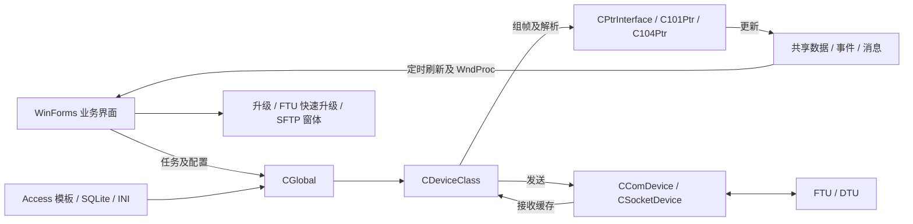

# FTU / DTU 上位机工程初始分析

分析日期：2026-10-23。范围为当前源码、显式项目清单和一次隔离 Debug 构建；未启动现有 EXE，未连接终端、主站或加密设备，未修改业务源码、配置或数据库。

当前状态（2026-10-24）：已建立本地 Git 仓库并完成依赖及代码基线清理，后续又修复未连接时的列表滚动及窗口切换绘制问题，用户复测反馈明显改善。Debug / Release 均为 0 错误、0 告警，28 项回归全部通过，详见第 9、10 节。第 1—7 节保留初始化时的分析与失败记录，不代表当前构建状态。

## 1. 工程结论

这是一个 Windows 桌面配电终端调试与配置工具。主要结构是 WinForms 界面、共享设备对象、101 / 104 规约实现、串口 / TCP 传输，以及模板数据库驱动的数据展示和参数管理。

| 项目 | 已确认事实 |
| --- | --- |
| 解决方案 / 项目 | 单一解决方案、单一 C# 项目，传统 MSBuild 工程 |
| 目标框架 | `.csproj` 和 `App.config` 均为 .NET Framework 4.8 |
| 进程架构 | Debug、Release 均指定 x86，解决方案平台名称仍为 Any CPU |
| 入口 | `Program.Main`，STA，`Application.Run(new MainForm())` |
| 有效主窗体 | `DtuTestManager/MyForms/MainForm.cs` |
| 编译范围 | 当前清单包含 166 个 C# 文件，其中 54 个为 `MyForms` / `4GForms` 中的非 Designer 窗体代码文件 |
| 输出 | `配电终端测试软件V2.0.exe`；默认目录分别为 `bin/Debug`、`bin/Release` |
| 版本管理 | 初始化时当前目录不是 Git 仓库，本次未创建 Git 仓库 |

目录名 `DtuTestManager20181109` 与解决方案中的 Visual Studio 2012 注释都不能代表当前源码版本或编译目标。现有二进制的来源及其与源码的一致性未验证。

## 2. 架构与主要调用链

此图表示主要职责关系。FTU 快速升级拥有独立 TCP Socket，SFTP 使用 SSH.NET，不是所有功能都经过 101 / 104 通道。

### 启动

1. `Program.cs:19` 启动实际主窗体。
2. `DtuTestManager/MyForms/MainForm.cs:67` 的 `MainForm_Load` 调用 `CGlobal.ReadSysSetting`，从应用基目录的 `PrjSet_Main.ini` 读取通道、规约、地址、模板和加密设置。
3. `CDeviceClass.InitConnect` 按规约类型创建 `C101Ptr` 或 `C104Ptr`；这里选择规约，实际打开通道发生在连接操作中。
4. `IniReadSqlData` 从当前工作目录的 `DefaultDevModule`、`DevModuleDataBase`、`工程模板` 读取 `.mdb`，选择配置的模板并初始化遥测、遥信、遥控、电度和参数列表。
5. 主窗体加载 `res/Log.png`、选择加密接口实现，建立监视窗口并显示实时控制界面。

### 发送与接收

- 普通命令：窗体 → `CGlobal.SendTaskOrder` → `CDeviceClass.SendTaskOrder` → 规约 `GetTaskBuffer` → `SendToDevice` → 串口或 TCP。
- 接收：串口 / TCP 接收线程 → `AddProcessBuff` → 10,240 字节环形缓存 → `ProcessThread` → `GetTheRightBuffContent` 抽帧 → `Process` 解析 / 应答。
- 规约层把结果写入设备的共享数据列表及事件对象，再由窗体定时刷新、刷新标记及 Windows 消息更新显示。
- 连接类型与规约类型分别配置，不能仅凭选择了“网络”就断定正在使用 104。
- TCP 支持客户端和监听模式；监听实现使用单个当前连接，接入新客户端时会关闭先前的接收连接，不应将其描述成多终端并行服务器。

### 参数事务

`CParaForm.GetParaOperationList` 生成分组任务；`TaskTime_Tick` 将任务交给 `m_Ptr.m_NowParaTask` 并发送，等待应答标志后推进下一组。读取、预置、固化、撤销对应不同任务，界面发送成功不能作为终端最终保存成功的依据。

## 3. 功能分布

| 功能 | 主要入口 / 实现 |
| --- | --- |
| 通信设置、实时遥测 / 遥信 / 电度、遥控 | `CMasterConForm`、`CRealCtrlForm`、`CYKForm`、`CDeviceClass` |
| 参数、工程参数、特殊参数 | `CParaForm`、`CEngPara`、`CEngParaNewForm`、`CSpeParaForm`、`CParaDefine.cs` |
| 终端通信与 4G 配置 | `CCommModeSet.cs` 中的 `CommuCFG`，配合 `4GForms` |
| 模板、厂站、终端、主站及转发表 | `CModulForm`、`CTransForm`、`CTransStation`、`CTransTerminal`、`CRouteTable` 等 |
| 校准及功能试验 | `CDataCheckForm`、`CTestFunForm`；规约任务包含系数、直流校验和相角相关命令 |
| 报文、事件、SOE 和历史 / 录波文件 | `CBufferViewForm`、`CEventMsgForm`、`CSOEMsgForm`、`CHisRecordForm`、`CFileCtrl`、`CSoePicForm` |
| 文件下装、普通升级、FTU 快速升级 | `CDownFileForm`、`CUpdataForm`、`CFTUFastUpdate` |
| SFTP 远端文件浏览、上传、下载、删除 | `CSFTPLogin` → `CSFTPMainForm` → `SFTPHelper` |
| 认证、证书和加密接口 | `CSecrteKeyForm`、`CEnCodePtr`、`CSecretInterface`，调用厂商原生 DLL |
| 规约试验 | `CTtestCaseForm`、`CTetstCasePro.cs` 中的 `C101Ptr` partial 实现，故意生成错误报文 |

以上确认的是源码中的功能入口与实现关系，未验证实际设备兼容性、试验覆盖率或标准符合性。

## 4. 数据和运行条件

- Access：`CDataBase.cs:36` 使用 `Microsoft.Jet.OLEDB.4.0`，读取 `.mdb` 模板；与 x86 进程选择有关。`CDataBase.sdf` 的存在不代表主数据访问使用 SQL Server Compact。
- SQLite：`CTransStation.IniSetAndConnSqlite` 打开厂站目录的 `MainCfgBase.db` 和 `UserCfgBase.db`，配合 `公共配置.ini`、终端 INI 和各类转发表。
- INI：全局连接设置使用应用基目录；多个模板、图片和数据库路径使用当前工作目录。部署、快捷方式和调试启动目录都会影响运行。
- `bin/Debug` 已含运行资源、模板、证书及多个厂商 DLL；SSH.NET 和 Docking 的工程 HintPath 也指向此处。它承担了运行包及依赖目录的角色，不能整体清理。
- 编译不会自动提供所有外部目录、数据库、原生组件或设备环境；临时目录中的构建输出不能直接当作完整运行包。

## 5. 本次构建验证

使用本机 Visual Studio 2022 的完整 MSBuild 对 `DtuTestManager.sln` 执行 `Build`，配置为 `Debug|Any CPU`，实际目标 x86。输出和中间文件均重定向到临时目录，未覆盖现有 `bin` / `obj`。

结果：**构建失败，尚不能确认当前源码可完整编译。**

| 现象 | 证据 / 影响 |
| --- | --- |
| 缺少 `System.Data.SQLite` 和 `System.Data.SQLite.Linq` | MSB3245；多个文件出现 CS0234 / CS0246。项目中的绝对 HintPath 在本机不存在，工程附带的原生 `sqlite3.dll` 不能替代托管程序集 |
| TeeChart 类型库未注册 | MSB3284，`TYPE_E_LIBNOTREGISTERED`；随后出现 `AxTeeChart` / `TeeChart` 类型缺失。运行目录虽有 Interop DLL，当前 COM 引用仍未解析成功 |
| 缺少 ReportViewer Common / WinForms 11.0.0.0 | MSB3245 引用警告；仍需确认这些历史引用是否为当前功能所需，不宜直接删除 |

原始日志：`C:\Users\LEE\AppData\Local\Temp\DtuTestManager-init-20261023-122246\build.log`。临时日志可能随系统清理失效；复现命令见 `AGENTS.md`。

没有自动安装依赖、注册 ActiveX、修改引用或注释业务代码。依赖补齐后的编译结果、Jet 可用性、原生 DLL 装载和界面运行均有待后续验证。

## 6. 静态发现与后续检查点

以下是初始化时的静态发现，均未在真实终端环境复现。后续修复及离线验证状态见第 9 节。

| 发现 | 源码依据与结论边界 |
| --- | --- |
| 104 自动心跳的一处分支永远不成立 | `DtuTestManager/MyClass/C104Ptr.cs:2152` 使用 `spanTime.Seconds >= 180`。`Seconds` 是分钟内的秒分量，不能达到 180；此分支无法自动生成测试报文。用 .NET `TimeSpan` 做离线语义核对，180 / 181 秒分别得到 `Seconds=0/1`，条件均为 false。不能据此断言所有手动心跳或连接功能都失效 |
| 接收缓存存在未释放锁的返回分支 | `DtuTestManager/MyClass/CDeviceClass.cs:279` 的 `GetProcessBuff` 在 `Monitor.Enter` 后有长度不一致时直接 `return 0` 的路径，未执行 `Monitor.Exit`；若该路径出现，会影响其他线程获取同一锁。发生条件及现场影响未复现 |
| Socket 发送也有未释放锁的返回路径 | `DtuTestManager/MyClass/CSocketClient.cs:54` 在进入锁后遇到空 Socket 直接返回，跳过后面的 `Monitor.Exit`；连接关闭与发送交错时的实际影响需要针对性验证 |
| 文件清单存在旧版本副本 | 例如项目目录下的 `MainForm.cs` 和 `MyForms/CCommModeSetForm.cs` 未参与编译；有效主窗体及通信配置分别是 `MyForms/MainForm.cs`、`MyForms/CCommModeSet.cs` |
| 一项非编译资源路径缺失 | `.csproj` 的 `None Include` 指向 `bin/Debug/res/TabFromBack.jpg`，文件当前不存在；它不是本次已观察到的编译失败原因，不应与 SQLite / COM 问题混淆 |

没有发现独立自动化测试项目。规约试验窗体是对终端发送报文的业务功能，不能作为开发者单元测试已经通过的证据。

后续如进入修复，建议先恢复可复现的构建环境，再针对心跳时间判断和具体锁释放路径建立最小离线验证；涉及规约收发、遥控、固化或升级的行为另在获准的测试环境中验证。

## 7. 初始化交付

本次仅新增根目录 `AGENTS.md` 和本分析文件，保存项目导航、调用约定、构建条件、已知限制及验证边界。未修改业务源码、工程配置、数据库或运行包，未建立 Git 仓库。

## 8. 后续依赖配置修复（2026-10-23）

前述第 5 节记录的是初始化时的失败结果。依赖方案先经临时构建验证，后续已落实到当前项目，不再依赖临时构建参数：

- 在 `DtuTestManager/lib/SQLite` 固定现有历史工程中的 System.Data.SQLite / Linq 1.0.118.0 及同套 x86 原生组件，将原先失效的 1.0.105.2 安装目录引用改为项目内相对路径。
- 原生 `SQLite.Interop.dll` 由项目内容项自动复制到生成 EXE 的同目录，Debug / Release 配置共用该复制规则。
- TeeChart 改为引用版本库内已有的 `AxInterop.TeeChart.dll`、`Interop.TeeChart.dll`，代替构建时重新从 COM 类型库生成包装代码。曲线界面、控件类型和业务调用均未删除或修改。
- 业务 `.cs` 文件、显式编译源码清单、目标框架及 x86 平台均未改动；未安装全局组件，未注册 COM。

验证：使用 `D:\Develop\VS2022\MicrosoftVisual Studio\2022\MSBuild\Current\Bin\amd64\MSBuild.exe` 对原 `DtuTestManager.sln` 执行普通 `Build`，配置 `Debug|Any CPU`，未覆盖输出路径或注入临时引用，返回码为 0；EXE 生成于 `DtuTestManager/bin/Debug/配电终端测试软件V2.0.exe`。对该默认输出中的 SQLite 托管 / 原生组件执行独立 x86 内存查询，结果通过。

仍存在两个 ReportViewer 引用警告及原有未使用变量警告。匹配的 TeeChart ActiveX 控件运行环境、现有配置库读写兼容性和真实设备通信尚未验证，不能将本次编译结果解释为这些功能已经可用。

## 9. 干净构建基线（2026-10-23）

用户授权优化源码并清除构建错误和告警。本次沿用 .NET Framework 4.8 / x86，不整体重构或升级其他依赖。此前落地的 SQLite 1.0.118.0 和 TeeChart 包装 DLL 引用配置一并纳入此基线；保留用户通过 Visual Studio 2022 保存的解决方案元数据。

### 告警清理

修复前对两个配置使用全新中间目录构建，均能编译，但各有 20 条告警：

| 告警 | 数量 | 处理 |
| --- | --- | --- |
| MSB3245 | 2 | 确认源码、资源和配置未使用 ReportViewer 后，移除 Common / WinForms 两个历史引用 |
| CS0168 | 16 | 删除未使用的异常变量名，保留原捕获类型、处理体及返回行为 |
| CS0219 | 2 | 移除仅包含 `int tt = 0`、没有实际作用的两个分支 |

没有降低告警级别或新增 `NoWarn` / `#pragma warning`。原有未参与构建的旧源码、Designer / 资源文件、现场配置和数据库均未修改。

### 已修复的具体问题

- `CDeviceClass.GetProcessBuff`：用 `lock` 保证长度不一致或复制抛异常时也释放接收缓存锁。长度检查、复制和返回长度均在同一个锁内完成；连续、跨尾、满容量及消费行为保持。
- `CSocketChannel.SendToSocket`：用 `lock` 保证空 Socket 提前返回时释放锁，保留原 Socket 异常处理及发送行为。
- `C104Ptr.GetTestOrSBuff`：心跳 180 秒与 S 帧 15 秒判断改用 `TotalSeconds`，修复心跳条件无法满足及 S 帧延迟跨分钟后的错误判断；阈值和报文格式保持。

这些结论来自源码核对与独立进程中的离线回归，不代表已经在真实终端复现现场故障。

### 验证结果

使用本机 Visual Studio 2022 完整 64 位 MSBuild，所有本次验证构建均启用 `/warnaserror`：

| 验证 | Debug | Release |
| --- | --- | --- |
| 全新隔离中间目录完整构建 | 0 错误、0 告警 | 0 错误、0 告警 |
| 原 `.sln` 默认输出目录构建 | 0 错误、0 告警 | 0 错误、0 告警 |
| 默认输出的独立 x86 回归 | 18 / 18 通过 | 18 / 18 通过 |

同一组回归先运行于修复前程序集：18 项中 7 项失败，分别覆盖空 Socket 锁释放、缓存的两种长度不一致和复制异常、181 / 241 秒心跳、65 秒 S 帧等待。修复后全部通过。新增检查不依赖外部测试框架，源码与执行脚本位于 `tests`，操作方法见 `tests/README.md`。SQLite 检查仅使用内存数据库，未写入现场配置库。

默认生成物：

- `DtuTestManager/bin/Debug/配电终端测试软件V2.0.exe`，本次生成时间为北京时间 2026-10-23 23:58:42。
- `DtuTestManager/bin/Release/配电终端测试软件V2.0.exe`，本次生成时间为北京时间 2026-10-23 23:58:49。

两种输出目录都含配套 SQLite 托管 DLL 及 EXE 同目录的 x86 原生 DLL。Release 和临时目录的输出仍不是完整运行包，模板、图片及现场配置不会因编译自动齐备。

日志位于以下临时目录，可能被系统清理：

- 修复前构建及失败回归：`C:\Users\LEE\AppData\Local\Temp\DtuTestManager-clean-baseline-before-20261023-154518`。
- 修复后完整隔离构建：`C:\Users\LEE\AppData\Local\Temp\DtuTestManager-clean-baseline-after-20261023-155507`。
- 默认输出构建及 18 项回归：`C:\Users\LEE\AppData\Local\Temp\DtuTestManager-clean-baseline-default-20261023-155837`。

### 基线边界

这是已验证可构建且具体回归通过的代码基线，不能宣称所有运行问题已消除。TeeChart 实际 32 位 ActiveX 控件、完整界面、Jet 模板访问、SQLite 既有厂站库的业务兼容性、加密设备和真实终端通信仍需在具备条件的测试环境验证。本次未启动上位机界面或连接设备，没有进行并发压力测试。

本地版本管理继续使用 `main`，未配置或上传远程仓库。提交仅包含工程、源码修复、必要依赖、文档和回归检查，不包含生成物、日志、证书或现场配置。

## 10. 列表滚动与窗口切换优化（2026-10-24）

用户确认多个列表和窗口普遍卡顿，未连接终端时也会发生。本次以 `68e5306` 干净构建基线为起点，处理共用绘制路径，不改通信、规约、参数事务、遥控或数据库业务。

### 证据与处理

| 已确认现象 | 处理 |
| --- | --- |
| `MyListView` 初始化把原生扩展样式整体设为 `0x2F`，覆盖了此前设置的原生双缓冲；独立控件检查确认 `LVS_EX_DOUBLEBUFFER` 未启用 | 使用 `ListView.DoubleBuffered`，并在原生样式中保留 `LVS_EX_DOUBLEBUFFER`；保留原样式、自绘、单元格编辑及图标行为 |
| 主窗体、参数窗体、遥控窗体、实际使用的模块页签均强制 `WS_EX_COMPOSITED`，对子控件树额外合成绘制 | 移除这些容器的强制合成样式，使用列表自身的双缓冲；遥控页的标准 ListView 单独开启双缓冲 |
| 实时监测页的 500 毫秒定时器无条件调用整个窗体的 `Invalidate`；20 次未连接的空闲调用产生 20 次无效重绘 | 去掉无条件整窗体重绘，保留原有数据刷新标志判断与单元格更新 |
| 嵌入窗口先加入父容器并显示，再设置最终停靠布局 | 提前设置 `DockStyle.Fill`，父容器通过 `SuspendLayout` / `ResumeLayout` 合并布局 |
| 实时列表逐行加入项目时没有批量更新范围 | 对初始化增加配对的 `BeginUpdate` / `EndUpdate`；遥信的原生图标设置在批量插入完成后执行，避免图标丢失 |

旧常量 `LVM_GETEXTENDEDLISTVIEWSTYLE` 实际值为设置消息 `0x1036`。现有调用依赖该行为，因此保留其数值与名称兼容性，新增正确命名的设置常量供新代码使用。检查程序用真正的读取消息 `0x1037` 核对样式。未在当前界面使用的旧 `MyTabControl` 没有改动。

### 验证

- 新增 10 项隐藏控件回归；在原基线的程序集上，整套 28 项中有 8 项失败，覆盖原生缓冲、四类容器合成绘制、遥控列表缓冲、空闲重绘及嵌入布局顺序。
- 修复后 Debug / Release 均在全新隔离目录完整构建，并以默认输出目录构建，启用 `/warnaserror`，结果均为 0 错误、0 告警；各自的 28 项回归全部通过。
- 回归确认 20 次空闲调用不再产生整窗体无效重绘，并保留列表的行数据、遥信图标、编辑控件及句柄重建后的双缓冲。
- 用户使用默认 Debug 输出，在未连接终端时复测列表拖动和窗口切换，反馈“明显改善”。这是用户实际交互反馈，未进行帧率或真实渲染时延的定量测量。

本次默认 Debug / Release EXE 的生成时间分别为北京时间 2026-10-24 00:23:44、00:23:50，路径仍为第 9 节所列的两个输出目录。原始独立控件检查和保留的基线程序集位于 `C:\Users\LEE\AppData\Local\Temp\DtuTestManager-ui-probe-20261023-161215`；修复前回归日志为 `C:\Users\LEE\AppData\Local\Temp\DtuTestManager-ui-before-regression.log`；修复后构建和回归日志位于 `C:\Users\LEE\AppData\Local\Temp\DtuTestManager-ui-after-20261023-162238`。临时目录可能被系统清理。

自动检查仅创建隐藏控件并使用合成数据，没有显示上位机主界面、执行启动加载或连接真实设备。用户此次反馈针对未连接场景；高频报文接收、现场数据库及完整功能仍沿用第 9 节的验证边界。
