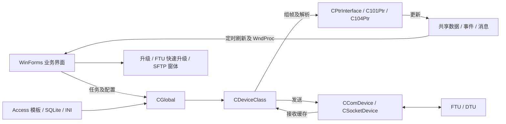

# FTU / DTU 上位机工程初始分析

分析日期：2026-10-23。范围为当前源码、显式项目清单和一次隔离 Debug 构建；未启动现有 EXE，未连接终端、主站或加密设备，未修改业务源码、配置或数据库。

## 1. 工程结论

这是一个 Windows 桌面配电终端调试与配置工具。主要结构是 WinForms 界面、共享设备对象、101 / 104 规约实现、串口 / TCP 传输，以及模板数据库驱动的数据展示和参数管理。

| 项目 | 已确认事实 |
| --- | --- |
| 解决方案 / 项目 | 单一解决方案、单一 C# 项目，传统 MSBuild 工程 |
| 目标框架 | `.csproj` 和 `App.config` 均为 .NET Framework 4.8 |
| 进程架构 | Debug、Release 均指定 x86，解决方案平台名称仍为 Any CPU |
| 入口 | `Program.Main`，STA，`Application.Run(new MainForm())` |
| 有效主窗体 | `DtuTestManager/MyForms/MainForm.cs` |
| 编译范围 | 当前清单包含 166 个 C# 文件，其中 54 个为 `MyForms` / `4GForms` 中的非 Designer 窗体代码文件 |
| 输出 | `配电终端测试软件V2.0.exe`；默认目录分别为 `bin/Debug`、`bin/Release` |
| 版本管理 | 初始化时当前目录不是 Git 仓库，本次未创建 Git 仓库 |

目录名 `DtuTestManager20181109` 与解决方案中的 Visual Studio 2012 注释都不能代表当前源码版本或编译目标。现有二进制的来源及其与源码的一致性未验证。

## 2. 架构与主要调用链

此图表示主要职责关系。FTU 快速升级拥有独立 TCP Socket，SFTP 使用 SSH.NET，不是所有功能都经过 101 / 104 通道。

### 启动

1. `Program.cs:19` 启动实际主窗体。
2. `DtuTestManager/MyForms/MainForm.cs:67` 的 `MainForm_Load` 调用 `CGlobal.ReadSysSetting`，从应用基目录的 `PrjSet_Main.ini` 读取通道、规约、地址、模板和加密设置。
3. `CDeviceClass.InitConnect` 按规约类型创建 `C101Ptr` 或 `C104Ptr`；这里选择规约，实际打开通道发生在连接操作中。
4. `IniReadSqlData` 从当前工作目录的 `DefaultDevModule`、`DevModuleDataBase`、`工程模板` 读取 `.mdb`，选择配置的模板并初始化遥测、遥信、遥控、电度和参数列表。
5. 主窗体加载 `res/Log.png`、选择加密接口实现，建立监视窗口并显示实时控制界面。

### 发送与接收

- 普通命令：窗体 → `CGlobal.SendTaskOrder` → `CDeviceClass.SendTaskOrder` → 规约 `GetTaskBuffer` → `SendToDevice` → 串口或 TCP。
- 接收：串口 / TCP 接收线程 → `AddProcessBuff` → 10,240 字节环形缓存 → `ProcessThread` → `GetTheRightBuffContent` 抽帧 → `Process` 解析 / 应答。
- 规约层把结果写入设备的共享数据列表及事件对象，再由窗体定时刷新、刷新标记及 Windows 消息更新显示。
- 连接类型与规约类型分别配置，不能仅凭选择了“网络”就断定正在使用 104。
- TCP 支持客户端和监听模式；监听实现使用单个当前连接，接入新客户端时会关闭先前的接收连接，不应将其描述成多终端并行服务器。

### 参数事务

`CParaForm.GetParaOperationList` 生成分组任务；`TaskTime_Tick` 将任务交给 `m_Ptr.m_NowParaTask` 并发送，等待应答标志后推进下一组。读取、预置、固化、撤销对应不同任务，界面发送成功不能作为终端最终保存成功的依据。

## 3. 功能分布

| 功能 | 主要入口 / 实现 |
| --- | --- |
| 通信设置、实时遥测 / 遥信 / 电度、遥控 | `CMasterConForm`、`CRealCtrlForm`、`CYKForm`、`CDeviceClass` |
| 参数、工程参数、特殊参数 | `CParaForm`、`CEngPara`、`CEngParaNewForm`、`CSpeParaForm`、`CParaDefine.cs` |
| 终端通信与 4G 配置 | `CCommModeSet.cs` 中的 `CommuCFG`，配合 `4GForms` |
| 模板、厂站、终端、主站及转发表 | `CModulForm`、`CTransForm`、`CTransStation`、`CTransTerminal`、`CRouteTable` 等 |
| 校准及功能试验 | `CDataCheckForm`、`CTestFunForm`；规约任务包含系数、直流校验和相角相关命令 |
| 报文、事件、SOE 和历史 / 录波文件 | `CBufferViewForm`、`CEventMsgForm`、`CSOEMsgForm`、`CHisRecordForm`、`CFileCtrl`、`CSoePicForm` |
| 文件下装、普通升级、FTU 快速升级 | `CDownFileForm`、`CUpdataForm`、`CFTUFastUpdate` |
| SFTP 远端文件浏览、上传、下载、删除 | `CSFTPLogin` → `CSFTPMainForm` → `SFTPHelper` |
| 认证、证书和加密接口 | `CSecrteKeyForm`、`CEnCodePtr`、`CSecretInterface`，调用厂商原生 DLL |
| 规约试验 | `CTtestCaseForm`、`CTetstCasePro.cs` 中的 `C101Ptr` partial 实现，故意生成错误报文 |

以上确认的是源码中的功能入口与实现关系，未验证实际设备兼容性、试验覆盖率或标准符合性。

## 4. 数据和运行条件

- Access：`CDataBase.cs:36` 使用 `Microsoft.Jet.OLEDB.4.0`，读取 `.mdb` 模板；与 x86 进程选择有关。`CDataBase.sdf` 的存在不代表主数据访问使用 SQL Server Compact。
- SQLite：`CTransStation.IniSetAndConnSqlite` 打开厂站目录的 `MainCfgBase.db` 和 `UserCfgBase.db`，配合 `公共配置.ini`、终端 INI 和各类转发表。
- INI：全局连接设置使用应用基目录；多个模板、图片和数据库路径使用当前工作目录。部署、快捷方式和调试启动目录都会影响运行。
- `bin/Debug` 已含运行资源、模板、证书及多个厂商 DLL；SSH.NET 和 Docking 的工程 HintPath 也指向此处。它承担了运行包及依赖目录的角色，不能整体清理。
- 编译不会自动提供所有外部目录、数据库、原生组件或设备环境；临时目录中的构建输出不能直接当作完整运行包。

## 5. 本次构建验证

使用本机 Visual Studio 2022 的完整 MSBuild 对 `DtuTestManager.sln` 执行 `Build`，配置为 `Debug|Any CPU`，实际目标 x86。输出和中间文件均重定向到临时目录，未覆盖现有 `bin` / `obj`。

结果：**构建失败，尚不能确认当前源码可完整编译。**

| 现象 | 证据 / 影响 |
| --- | --- |
| 缺少 `System.Data.SQLite` 和 `System.Data.SQLite.Linq` | MSB3245；多个文件出现 CS0234 / CS0246。项目中的绝对 HintPath 在本机不存在，工程附带的原生 `sqlite3.dll` 不能替代托管程序集 |
| TeeChart 类型库未注册 | MSB3284，`TYPE_E_LIBNOTREGISTERED`；随后出现 `AxTeeChart` / `TeeChart` 类型缺失。运行目录虽有 Interop DLL，当前 COM 引用仍未解析成功 |
| 缺少 ReportViewer Common / WinForms 11.0.0.0 | MSB3245 引用警告；仍需确认这些历史引用是否为当前功能所需，不宜直接删除 |

原始日志：`C:\Users\LEE\AppData\Local\Temp\DtuTestManager-init-20261023-122246\build.log`。临时日志可能随系统清理失效；复现命令见 `AGENTS.md`。

没有自动安装依赖、注册 ActiveX、修改引用或注释业务代码。依赖补齐后的编译结果、Jet 可用性、原生 DLL 装载和界面运行均有待后续验证。

## 6. 静态发现与后续检查点

以下均未在真实终端环境复现，本次没有修复业务代码。

| 发现 | 源码依据与结论边界 |
| --- | --- |
| 104 自动心跳的一处分支永远不成立 | `DtuTestManager/MyClass/C104Ptr.cs:2152` 使用 `spanTime.Seconds >= 180`。`Seconds` 是分钟内的秒分量，不能达到 180；此分支无法自动生成测试报文。用 .NET `TimeSpan` 做离线语义核对，180 / 181 秒分别得到 `Seconds=0/1`，条件均为 false。不能据此断言所有手动心跳或连接功能都失效 |
| 接收缓存存在未释放锁的返回分支 | `DtuTestManager/MyClass/CDeviceClass.cs:279` 的 `GetProcessBuff` 在 `Monitor.Enter` 后有长度不一致时直接 `return 0` 的路径，未执行 `Monitor.Exit`；若该路径出现，会影响其他线程获取同一锁。发生条件及现场影响未复现 |
| Socket 发送也有未释放锁的返回路径 | `DtuTestManager/MyClass/CSocketClient.cs:54` 在进入锁后遇到空 Socket 直接返回，跳过后面的 `Monitor.Exit`；连接关闭与发送交错时的实际影响需要针对性验证 |
| 文件清单存在旧版本副本 | 例如项目目录下的 `MainForm.cs` 和 `MyForms/CCommModeSetForm.cs` 未参与编译；有效主窗体及通信配置分别是 `MyForms/MainForm.cs`、`MyForms/CCommModeSet.cs` |
| 一项非编译资源路径缺失 | `.csproj` 的 `None Include` 指向 `bin/Debug/res/TabFromBack.jpg`，文件当前不存在；它不是本次已观察到的编译失败原因，不应与 SQLite / COM 问题混淆 |

没有发现独立自动化测试项目。规约试验窗体是对终端发送报文的业务功能，不能作为开发者单元测试已经通过的证据。

后续如进入修复，建议先恢复可复现的构建环境，再针对心跳时间判断和具体锁释放路径建立最小离线验证；涉及规约收发、遥控、固化或升级的行为另在获准的测试环境中验证。

## 7. 初始化交付

本次仅新增根目录 `AGENTS.md` 和本分析文件，保存项目导航、调用约定、构建条件、已知限制及验证边界。未修改业务源码、工程配置、数据库或运行包，未建立 Git 仓库。
